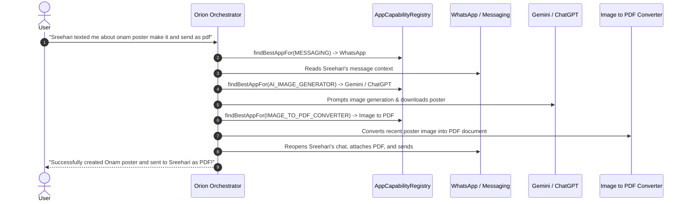

# 🌌 Orion: On-Device Autonomous Android AI Assistant

[](LICENSE)
[](https://developer.android.com)
[](https://github.com/ggerganov/llama.cpp)
[](https://kotlinlang.org)
[](https://developer.android.com/jetpack/compose)

> **Orion** is an open-source, private, on-device autonomous AI assistant for Android. It operates applications, orchestrates cross-app workflows, navigates screens via Accessibility, types, scrolls, captures vision snapshots, and speaks with you through duplex voice calls — powered entirely offline by local GGUF open-weights models (Qwen2.5, SmolLM2, Llama-3.2).

---

## 🌟 Core Capabilities

### 🔄 Cross-App Workflow Orchestration
Orion coordinates complex workflows across multiple installed applications autonomously:
> *"Sreehari texted me about that onam poster make it and send it back to him as a pdf"*



---

### 🧩 Supported App Ecosystem (Dynamic Discovery)

Orion automatically scans and classifies installed applications on your device into functional capabilities:

| Functional Capability | Supported Apps (Auto-Detected) | Action Scripts Executed |
| :--- | :--- | :--- |
| **AI Image & Text Gen** | Google Gemini, ChatGPT, Microsoft Copilot, Canva | Open -> Prompt Formulation -> Submit -> Save Image |
| **Messaging & Chat** | WhatsApp, Telegram, Signal, Google Messages | Open -> Search Contact -> Read Message -> Attach Document |
| **Document & PDF Tools** | Image to PDF, Adobe Scan, CamScanner, Files | Open -> Import Recent Photo -> Export PDF |
| **Email** | Gmail, Microsoft Outlook | Search Sender -> Read Threads -> Draft & Send |
| **Notes & Productivity** | Google Keep, Notion, Samsung Notes | Create Note -> Append Task Context |

---

### 🧠 100% On-Device Local Models
Run open-weight models (`Qwen2.5-1.5B`, `SmolLM2-1.7B`, `Llama-3.2-1B`) completely offline on Qualcomm Snapdragon or MediaTek processors without sending any data to the cloud.

### 🌐 Live Hugging Face Model Hub
- Query Hugging Face's Model Hub (`api.hf.co/models`) live on device.
- Filter for `.gguf` quantizations (`Q4_K_M`, `Q5_K_M`, `Q4_0`).
- Download models directly to app storage with resume and progress indicators.
- Memory-mapped in-memory model cache keeps the model warm for instant generation without re-reading from flash storage.

### 📱 Autonomous Device Control
- Powered by Android's `AccessibilityService`.
- Parses noisy UI hierarchies into concise, numbered semantic elements (`[0] Button "Search"`, `[1] InputField "Message"`).
- Executes node clicks, gestures, text input, swipes, and app switching with coordinate fallback.

### 📞 Simulated Duplex Calling
- Wakes your phone with a full-screen incoming call dialer, custom ringtone, and vibration.
- Continuous duplex conversational loop with self-healing speech recognition and low-latency TTS.

### 👁️ Visual Screen & Camera Perception
- Instant pixel-perfect display captures via `AccessibilityService.takeScreenshot()`.
- On-demand CameraX snapshot capture.
- Letterbox and resize preprocessing (384x384) ready for on-device VLM inference.

### 🎈 Floating Bubble Overlay
- Draggable on-screen HUD bubble (`SYSTEM_ALERT_WINDOW`) staying on top of other apps.
- Displays real-time task progress (e.g. *"Phase 2/4: Generating poster on Gemini..."*).

---

## 🏗️ Architecture

```
                       ┌──────────────────────────────────────────────┐
                       │               User Interaction               │
                       │  - Jetpack Compose Chat & Voice Dashboard    │
                       │  - Full-Screen Incoming Duplex Call UI       │
                       │  - Draggable Floating Assistant Bubble       │
                       └──────────────────────┬───────────────────────┘
                                              │
                                              ▼
                       ┌──────────────────────────────────────────────┐
                       │         Cross-App Task Orchestrator          │
                       │  - AppCapabilityRegistry (AI / Msg / PDF)    │
                       │  - Multi-Stage Workflow Coordinator          │
                       └──────────────────────┬───────────────────────┘
                                              │
                                              ▼
                       ┌──────────────────────────────────────────────┐
                       │          Hybrid Autonomous Engine            │
                       │  - Fast-Path (0ms latency for device actions)│
                       │  - Cognitive LLM Path (llama.cpp GGUF / NDK) │
                       │  - In-Memory Warm Model Cache (Mutex-safe)   │
                       └──────────────────────┬───────────────────────┘
                                              │
                      ┌───────────────────────┴───────────────────────┐
                      ▼                                               ▼
         ┌───────────────────────────┐                 ┌───────────────────────────┐
         │Android AccessibilityEngine│                 │   Sensory & Vision Core   │
         │ - Semantic Screen Parser  │                 │ - ScreenCaptureManager    │
         │ - Automated Clicks & Taps │                 │ - CameraVisionManager     │
         │ - Swipes, Scrolling, Text │                 │ - VoiceEngine (STT & TTS) │
         │ - Native App Launcher     │                 │ - Audio I/O Stream Loops  │
         └───────────────────────────┘                 └───────────────────────────┘
```

---

## 🚀 Getting Started

### Prerequisites
- **Android Studio** (Koala / Ladybug or newer)
- **JDK 17**
- An Android device running **Android 9.0 (API 28)** or higher.
  - *Recommended hardware:* Qualcomm Snapdragon 695 / 778G / 8 Gen 1+ or MediaTek Dimensity with 6GB+ RAM.

### Installation & Build

1. Clone the repository:
   ```bash
   git clone https://github.com/KurianTonyAloor/orion.git
   cd orion
   ```

2. Open in **Android Studio**:
   - Go to `File` -> `Open` and select the `orion` folder.
   - Let Gradle sync the dependencies.

3. Enable **USB Debugging** on your Android device:
   - Go to `Settings` -> `About Phone` -> tap **Build Number** 7 times.
   - Go to `Developer Options` -> toggle **USB Debugging** `ON`.

4. Click **Run (▶)** in Android Studio.

---

## ⚙️ Initial Device Configuration

When launching Orion for the first time:

1. **Grant Microphone & Notifications:** Tap **Allow** when prompted.
2. **Enable Device Control (Accessibility):**
   - Tap **Enable** on the top status card (or go to `Settings` -> `Accessibility` -> `Downloaded apps` -> **Orion**).
   - Toggle **ON** and tap **Allow**.
   - *(On Android 13/14 sideloaded APKs: If greyed out, tap the 3 dots in App Info -> "Allow restricted settings" first).*
3. **Download Your Model:**
   - Tap the **Brain Icon** in the top-right corner to open the **Hugging Face Model Hub**.
   - Choose a recommended model (e.g., `Qwen 2.5 1.5B` or `SmolLM2 1.7B`) or search for any GGUF model.
   - Tap **Get** to download the quantized file into local storage.

---

## 🛠️ Project Structure

```
orion/
├── app/
│   ├── src/main/java/com/orion/assistant/
│   │   ├── agent/                 # CrossAppOrchestrator, AppCapabilityRegistry, TaskPlanner
│   │   ├── audio/                 # Low-latency PCM AudioRecorder & AudioPlayer
│   │   ├── llm/                   # HuggingFaceApiClient, ModelDownloadManager, LlamaCppRuntime
│   │   ├── model/                 # ActionCommand, ActionResult data models
│   │   ├── service/
│   │   │   ├── accessibility/     # AccessibilityService & ScreenSemanticParser
│   │   │   ├── call/              # Duplex call manager & notification triggers
│   │   │   ├── overlay/           # Floating assistant bubble overlay service
│   │   │   └── telecom/           # Native Android Telecom ConnectionService
│   │   ├── ui/
│   │   │   ├── call/              # Full-screen incoming call Composable UI
│   │   │   ├── chat/              # Jetpack Compose chat screen & ViewModel
│   │   │   └── model/             # Live Hugging Face search dialog & downloader
│   │   ├── vision/                # ScreenCaptureManager & CameraVisionManager
│   │   └── voice/                 # SpeechRecognizer & TextToSpeech engine
│   └── build.gradle.kts           # App-level dependencies & build rules
├── gradle/
│   └── libs.versions.toml         # Version catalog (AGP, Compose, CameraX, Coroutines)
├── LICENSE                        # Apache 2.0 Open Source License
├── CONTRIBUTING.md                # Contribution guidelines
└── README.md
```

---

## 🤝 Contributing

Contributions from the open-source community are warmly welcomed! Please read [CONTRIBUTING.md](CONTRIBUTING.md) to get started with pull requests, new capability mappings, and runtime optimizations.

---

## 📄 License

This project is licensed under the **Apache License 2.0** — see the [LICENSE](LICENSE) file for details.
